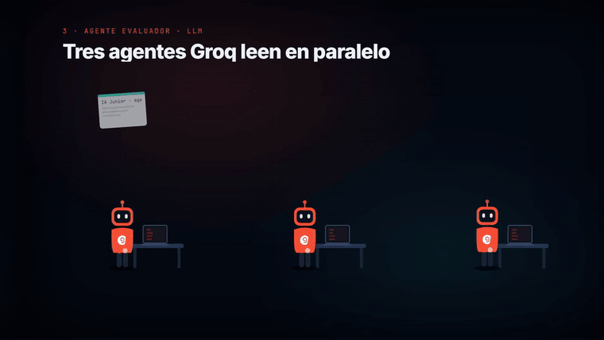
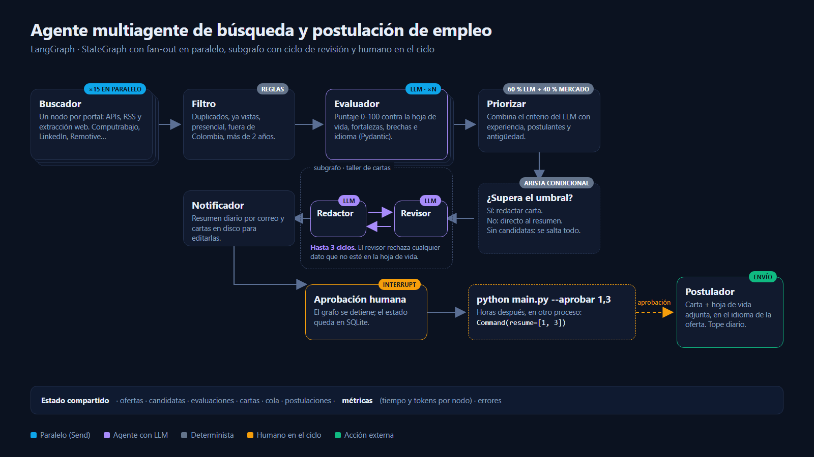
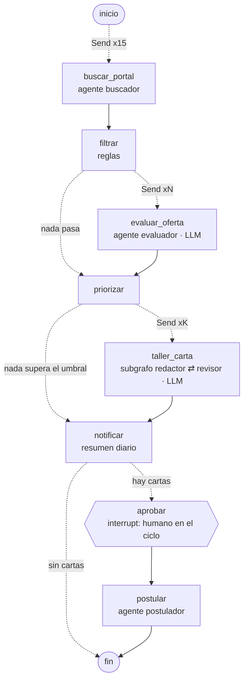
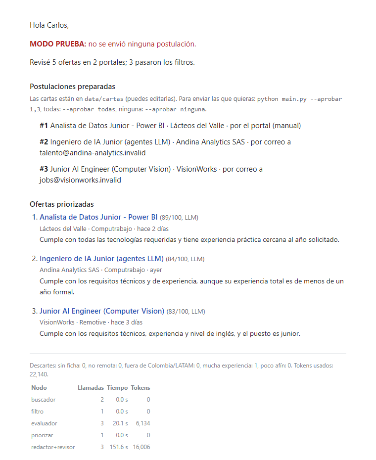

# Sistema multiagente de búsqueda y postulación de empleo (LangGraph)

<p align="center"></p>

Sistema que todos los días recorre 15 portales de empleo, filtra las ofertas que encajan con un
perfil junior remoto en IA y datos, las evalúa con un LLM contra la hoja de vida, redacta y revisa una carta
de presentación para las mejores y, **después de la aprobación del candidato**, se postula enviando la hoja de
vida por correo.

Empezó como un script secuencial basado en reglas (`agente/portales.py`, la versión 1) y se reconstruyó como un
grafo de LangGraph para agregarle agentes con LLM, paralelismo, persistencia y un punto de control humano.

<p align="center"></p>
<p align="center">
  <a href="docs/agente_empleo.mp4"><b>▶ Ver el video completo (79 s)</b></a> ·
  <a href="docs/demo.mp4">Salida real en la terminal (36 s)</a>
</p>

El video muestra cada nodo del grafo como un trabajador. Lo que hacen no es una recreación:
[`docs/video/exportar.py`](docs/video/exportar.py) lee el estado final de la corrida `python main.py --demo` desde el
checkpointer de LangGraph (puntajes, fortalezas, tiempos y tokens por agente) y la carta que se generó, y el video se arma
con esos datos en [Remotion](https://www.remotion.dev/). La demo usa las ofertas ficticias de `tests/ofertas_demo.py`
con el modelo real (`openai/gpt-oss-120b` en Groq).



## Arquitectura



| Agente / nodo | Qué hace | Patrón de LangGraph |
|---|---|---|
| **Buscador** | Un nodo por portal (APIs, RSS, extracción web), los 15 en paralelo | Fan-out con `Send` + reducer `operator.add` |
| **Filtro** | Quita duplicados, ofertas ya vistas, presenciales, fuera de Colombia y con más de 2 años de experiencia | Nodo determinista (sin costo de tokens) |
| **Evaluador** | Califica cada oferta de 0 a 100 contra la hoja de vida, con fortalezas, brechas e idioma | Fan-out + salida estructurada (Pydantic), reintento con el error de validación y plan B por reglas |
| **Priorizar** | Combina el criterio del LLM (60 %) con señales del mercado (40 %): experiencia, postulantes, antigüedad, inglés | Arista condicional: sin candidatas no se redacta nada |
| **Redactor ⇄ Revisor** | El redactor escribe la carta solo con hechos de la hoja de vida; el revisor la rechaza si inventa algo, se equivoca de empresa o de idioma, y el ciclo se repite hasta 3 veces | Subgrafo con ciclo condicional (reflexión) |
| **Notificador** | Envía el resumen del día y deja cada carta en `data/cartas/` para editarla | |
| **Aprobación** | El grafo se detiene hasta que el candidato decide qué enviar; la pausa sobrevive entre procesos | `interrupt()` + `Command(resume=...)` + checkpointer SQLite |
| **Postulador** | Envía la carta con la hoja de vida adjunta (en el idioma de la oferta) si la oferta da un correo de postulación; si no, deja la carta lista con el enlace al portal | Registro anti-duplicados y tope diario |

## Decisiones de diseño

- **Ninguna postulación sale sin aprobación humana** (modo por defecto `aprobacion`). Hay modo `automatico`, que solo
  envía cartas aprobadas por el revisor, a ofertas con correo de postulación explícito y con un tope diario.
- **El LLM nunca tumba el grafo.** Cada agente con LLM tiene un plan B: si no hay clave, se agota el límite de tasa o la
  respuesta no valida contra el esquema, el evaluador usa el puntaje por reglas y la carta queda marcada para revisión.
- **La hoja de vida es la única fuente de verdad, verificada en código.** El revisor debe listar cada afirmación de la
  carta con la cita literal de la hoja de vida que la respalda, y `cita_valida()` comprueba que esa cita exista de verdad
  en el texto del PDF (tolera cortes de línea y ligaduras). Una afirmación sin cita real tumba la carta aunque el LLM la
  haya aprobado, y vuelve al redactor con la frase exacta a corregir. En la primera prueba con el modelo real, sin esta
  verificación, el revisor aprobó una carta que decía «extensive Python scripting» en una experiencia que no lo menciona.
  Antes del revisor corren chequeos deterministas gratuitos (marcadores sin rellenar, largo, idioma, firma).
- **La verificación reduce las exageraciones, no las elimina.** Una paráfrasis cercana a una cita válida puede pasar; por
  eso el modo por defecto exige leer y aprobar cada carta.
- **Límite de tasa.** El plan gratuito de Groq da unos 8.000 tokens por minuto: el cliente limita a 2 llamadas simultáneas
  y, ante un 429, espera lo que indica el servidor y reintenta.
- **Correo de postulación solo con contexto.** Un correo suelto en la oferta (privacidad, soporte) no se toma como canal:
  tiene que aparecer junto a «envía tu hoja de vida», «apply», «CV»...
- **Métricas por nodo**: tiempo y tokens de cada agente quedan en el estado y salen al pie del resumen diario.

## Resultados medidos

| | Versión 1 (script secuencial) | Versión 2 (LangGraph) |
|---|---|---|
| Tiempo en 15 portales | 4 min 38 s (corrida del 2026-11-09) | 1 min 16 s (2026-11-11, 1.354 ofertas revisadas) |
| Evaluación | Reglas y palabras clave | LLM con salida estructurada + reglas como respaldo |
| Postulación | No | Carta revisada + envío con hoja de vida, previa aprobación |

Demo con el modelo real (3 ofertas, 3 cartas): 22.140 tokens, de los cuales 6.134 son del evaluador y 16.006 del ciclo
redactor ⇄ revisor. El resumen diario muestra ese desglose por nodo:

<p align="center"></p>

## Uso

```bash
python -m venv .venv && .venv/Scripts/activate      # Windows
pip install -r requirements.txt
copy config.example.json config.json                 # pegar la clave de Groq y las rutas de la hoja de vida

python main.py --demo          # ofertas de ejemplo, sin internet ni envíos
python main.py --prueba        # portales reales; no envía nada (las postulaciones quedan como .eml)
python main.py                 # corrida diaria: resumen por correo y pausa para aprobar
python main.py --aprobar 1,3   # reanuda el grafo y envía las postulaciones 1 y 3 (o: todas | ninguna)
python main.py --grafo         # diagrama Mermaid del grafo compilado
pytest -q                      # 7 pruebas con un modelo falso: flujo, ciclo de revisión, citas, pausa y reanudación
```

Para regenerar el video, la portada y la tarjeta animada:

```bash
python docs/video/exportar.py            # estado de la corrida demo → docs/video/src/datos.json
cd docs/video
npm install
npx remotion render AgenteEmpleo ../agente_empleo.mp4
npx remotion still PortadaBanner ../portada.png
```

Modelo por defecto: `openai/gpt-oss-120b` en Groq (plan gratuito). Las credenciales de Gmail (contraseña de
aplicación) se leen de un JSON aparte que nunca se sube al repositorio.

## Estructura

```
agente/
  grafo.py      grafo principal, subgrafo de cartas y todos los nodos
  llm.py        esquemas Pydantic de cada agente y cliente del modelo con reintentos
  prompts.py    instrucciones de evaluador, redactor y revisor
  correo.py     resumen diario, extracción del correo de postulación y envío con adjunto
  portales.py   los 15 portales y los filtros por reglas (versión 1)
docs/            diagrama, capturas y videos
  video/        proyecto Remotion del video (exportar.py lee la corrida demo)
  fuentes/      salidas de terminal de la demo y el generador del video de terminal
  config.py     configuración y valores por defecto
tests/          pruebas sin red con un modelo falso y ofertas ficticias
main.py         línea de comandos
```

Nota de compatibilidad: con Python 3.14 en Windows con Control inteligente de aplicaciones activo, la DLL de
`pydantic-core` 2.50 queda bloqueada; `requirements.txt` fija `pydantic-core==2.41.5`, que sí carga.
